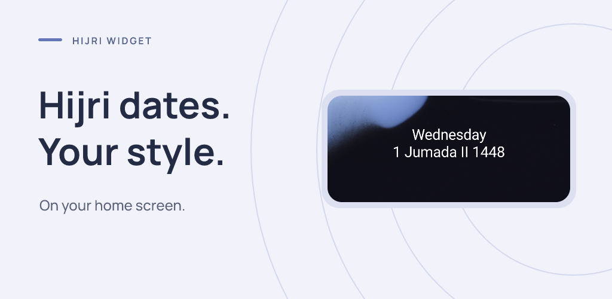
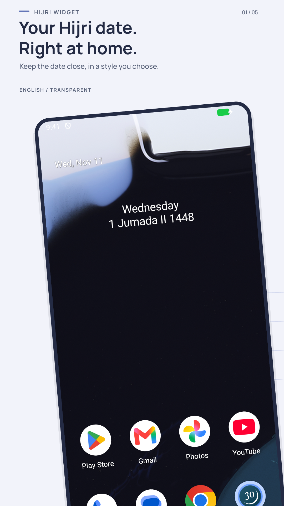
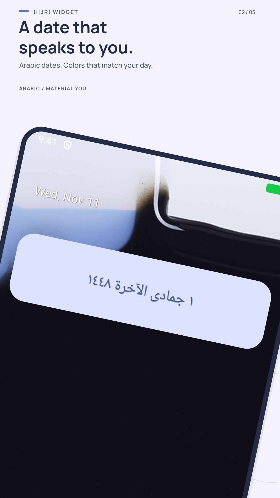
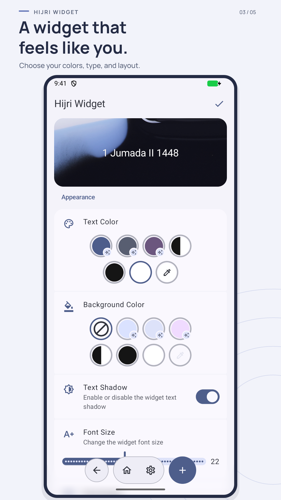
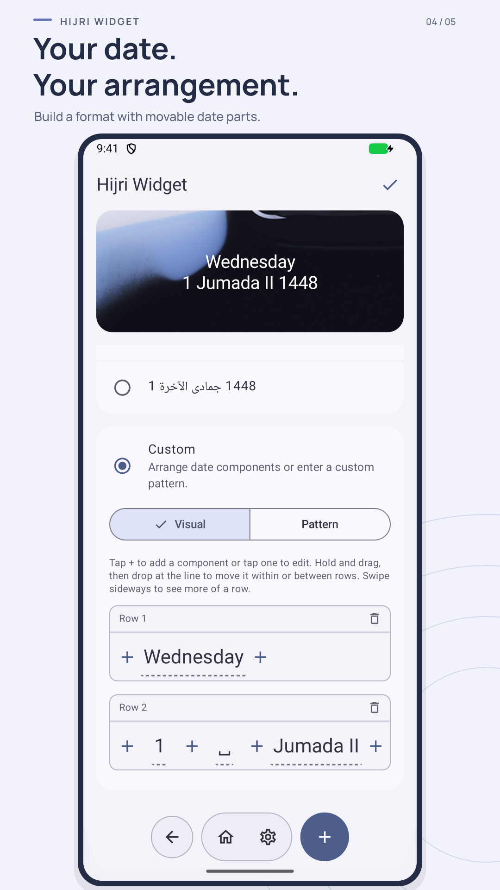
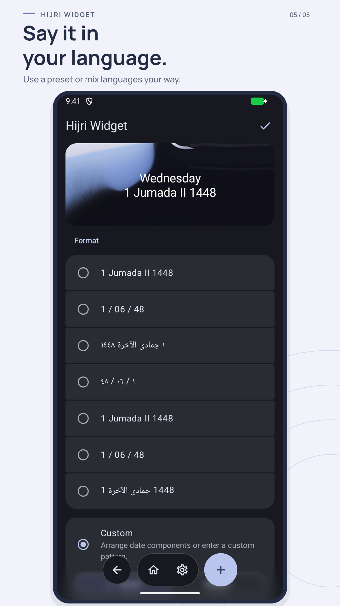

<h1 align="center">Hijri Widget</h1>

Your Hijri date, right on your Android home screen. 
Choose your colors, fonts, languages, and layout.

  

## Download

  <a href="https://play.google.com/store/apps/details?id=me.amrbashir.hijriwidget">
    <picture>
      
    </picture>
  </a>
  <a href="https://github.com/amrbashir/hijri-widget/releases/latest">
    <picture>
      
    </picture>
  </a>
  <a href="https://apps.obtainium.imranr.dev/redirect?r=obtainium://add/https://github.com/amrbashir/hijri-widget/">
    <picture>
      
    </picture>
  </a>

Requires **Android 8.0 or later**. Works offline, with no ads or account required.

## Features

- **Make each widget your own.** Customize placed widgets independently and preview changes
  against your wallpaper before saving.
- **Match your home screen.** Choose Material You colors on Android 12+, custom colors, or a
  transparent background. Adjust the font, size, weight, shadow, alignment, and padding.
- **Arrange your date.** Start with a preset, move components between rows in the visual
  editor, or enter a custom date pattern.
- **Use your language.** Follow the device language or choose a language for each date
  component, including mixed-language formats. The app interface supports English and Arabic.
- **Follow your calendar.** Choose Islamic, Islamic Umm al-Qura, or Islamic Civil calculation,
  adjust the Hijri date by up to ±2 days, and set the time when a new Hijri day begins.

## Screenshots

  
  

<table>
  <tr>
    <td></td>
    <td></td>
    <td></td>
  </tr>
  <tr>
    <td align="center">Colors and appearance</td>
    <td align="center">Visual date editor</td>
    <td align="center">Languages and presets</td>
  </tr>
</table>
